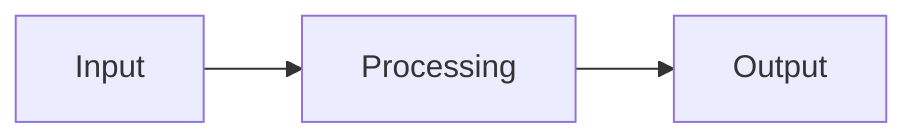

## Summary

<!-- Concise summary of what this PR changes and why. -->

## Architecture / Flow (optional)

<!-- Include a Mermaid diagram when the change spans multiple components, introduces a state machine/pipeline, or resolves a complex issue. Remove this section for small/straightforward changes. -->

## Key Changes

- 

## Test Plan

- [ ] Unit tests added / updated (`xcodebuild test`)
- [ ] Static checks pass (`./scripts/check-theme-colors.sh`, `./scripts/check-audit-wiring.sh`, `./scripts/check-entitlements.sh`)

<!-- Closes #ISSUE -->
