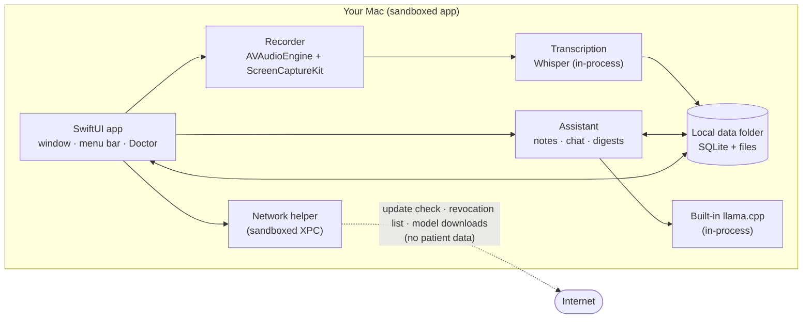
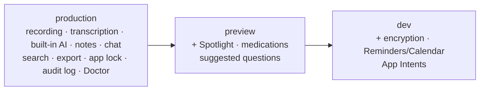
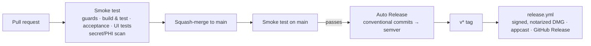

# Aletheia

**Session notes for therapists, written on your Mac and kept on your Mac.**

Aletheia records a video-call therapy session, transcribes it, drafts a progress note, and lets you search and ask questions across a patient's history. The speech recognition and the AI both run on your computer. Patient data is never sent to a server, and there is no analytics or telemetry.

[For therapists](#for-therapists) · [How it works](#how-it-works) · [For developers](#for-developers) · [Setup guide](docs/SETUP-GUIDE.md) · [Security](SECURITY.md) · [Privacy](PRIVACY.md) · [Changelog](CHANGELOG.md)

> **License:** source-available, not open source. All rights reserved; see [LICENSE](LICENSE), [Terms](TERMS.md) and [Privacy](PRIVACY.md).

---

### Privacy first

- No patient content leaves the Mac. Recording, transcription, notes and chat are all local.
- The app itself has no network access. A separate sandboxed helper makes the only requests, none carrying patient data: the update check, the license revocation list, and the speech and AI models you choose to download. Settings → Privacy & Security shows this from the app's own signature.
- Raw audio is deleted after transcription unless you opt in to keeping it and encryption is on.
- Apple Intelligence and macOS Writing Tools are kept off patient data, so every AI path is provably on-device.

Details: [SECURITY.md](SECURITY.md), [PRIVACY.md](PRIVACY.md), [docs/DATA-SAFETY.md](docs/DATA-SAFETY.md). Aletheia is a tool, not clinical advice; read [CONSENT.md](CONSENT.md) before recording anyone.

---

## For therapists

Aletheia is in beta. [Apply on the Astrea Labs site](https://astrealabs.com/projects/aletheia); accepted testers receive a license key by email.

You need **macOS 14 or newer** and 4 to 8 GB of free disk space. Apple Silicon with 16 GB of memory gives the best results; 8 GB works with a smaller model, which the app picks for you.

### Install and set up

1. Download the latest `Aletheia-<version>.dmg` from the [Releases page](https://github.com/mgwedd/aletheia/releases), open it, and drag **Aletheia** into **Applications**.
2. On first launch, paste your license key, then work down the checklist: Terms & Privacy, data folder (must be on this Mac), microphone, call audio capture (macOS calls it "Screen Recording"; only the call's audio is used), and the transcription and AI model downloads. Click **Finish setup** when every row is green.

After the downloads, Aletheia works offline. If a row won't turn green, see the [Setup guide](docs/SETUP-GUIDE.md).

### Your first session

1. Click **Add Patient** (+), enter a name, then click **New session**.
2. Open your video call as usual and click **Record Session** (or use the menu bar icon). Click **Stop** when finished. Transcription starts by itself if **Settings → General → Transcribe automatically** is on; otherwise click **Transcribe**.
3. Open the **Notes** tab to jot your own notes and generate the progress note (narrative, SOAP, DAP, BIRP or GIRP, set in **Settings → Formats**). Edit it, then **Copy** it into your record or **Export** it as PDF, Word or Markdown.
4. Use **Ask** to question a session, or **Ask about this patient** on the patient page. Answers say what was read.
5. **Search all patients** (⌘F) searches patients, sessions, notes, comments and transcripts. **Help → Keyboard Shortcuts** (⌘/) lists the rest.

Always read the transcript and note before relying on them: names and clinical terms are often misheard, and AI drafts can be wrong. If something looks wrong, **Help → Aletheia Doctor…** gives a health report with no patient information in it.

---

## How it works



- **Transcription:** [whisper.cpp](https://github.com/ggml-org/whisper.cpp) runs in-process on the GPU, with Silero VAD skipping silence. Microphone and call audio are captured as separate tracks and merged by timestamp.
- **AI:** the official llama.cpp XCFramework runs in-process. Models come from ggml-org on Hugging Face, pinned to a revision and verified by SHA-256: Llama 3.1 8B on Macs with 16 GB or more, Gemma 4 E2B otherwise. A prompt never gets silently truncated; one over the Mac's budget fails with a clear message.
- **Patient-wide answers** read notes and comments first, then whole transcripts when they fit, otherwise stored session summaries plus passages found by a local full-text search. Each answer carries a label saying what it read.
- **Storage:** a local data folder of SQLite plus per-session files, with optional encryption (AES-256-GCM, dev tier), app lock, a tamper-evident audit log, and encrypted Back Up Now / Restore archives alongside Time Machine.

The only third-party code is the official whisper.cpp and llama.cpp builds, pinned by checksum. Deeper detail lives in [docs/DESIGN-DECISIONS.md](docs/DESIGN-DECISIONS.md), [docs/ENCRYPTION.md](docs/ENCRYPTION.md), [docs/DATA-SAFETY.md](docs/DATA-SAFETY.md), [docs/THREAT-MODEL.md](docs/THREAT-MODEL.md), and, for exact behaviour, [docs/spec/BEHAVIOR-REFERENCE.md](docs/spec/BEHAVIOR-REFERENCE.md).

### Build tiers

Features are grouped into tiers chosen at compile time. Each includes the one before it; the released DMG is **production**.



Debug builds are `dev`; Release builds are `production`. Tiers are set by the `ALETHEIA_PREVIEW` and `ALETHEIA_DEV` compilation conditions in `project.yml`.

---

## For developers

### Build and test

You need a Mac with **Xcode 16+** and [XcodeGen](https://github.com/yonaskolb/XcodeGen) (`brew install xcodegen`). There is no checked-in `.xcodeproj`; `project.yml` is the source of truth.

```bash
git clone https://github.com/mgwedd/aletheia.git && cd aletheia
./scripts/build.sh            # generates the project, Release build, ad-hoc signed → dist/Aletheia.app
xcodegen generate && open Aletheia.xcodeproj    # or work in Xcode
xcodebuild test -scheme Aletheia -destination 'platform=macOS'
```

To test a specific tier, pass `SWIFT_ACTIVE_COMPILATION_CONDITIONS`: `"DEBUG"` (production), `"DEBUG ALETHEIA_PREVIEW"` or `"DEBUG ALETHEIA_PREVIEW ALETHEIA_DEV"`.

### Repository map

```
Sources/App/              the app: Models, Views, Services (recorder, transcriber, assistant,
                          store, search, digests, crypto, license, …), FixtureMode (Debug only)
Sources/NetworkHelper/    the sandboxed XPC helper, the only code that touches the network
Sources/WhisperEngine/    whisper.cpp wrapper
Packages/                 pinned llama.cpp and whisper.cpp XCFrameworks
Tests/AletheiaTests/      unit tests
Tests/AletheiaAcceptance/ acceptance tests, one per criterion
Tests/AletheiaUITests/    XCUITest suite against the real app
scripts/                  build, release and CI guard scripts
docs/                     setup, data safety, encryption, threat model, design decisions, spec/
```

### Testing

The product's requirements live in [docs/spec/ACCEPTANCE-CRITERIA.md](docs/spec/ACCEPTANCE-CRITERIA.md), one line each with a stable ID. The acceptance and UI tests are those requirements in executable form: they drive the real Debug app through XCUITest in a hermetic fixture mode, and a requirement counts as met only when its test passes in CI. Unit tests cover internals. See [docs/spec/EXECUTION-LAYER.md](docs/spec/EXECUTION-LAYER.md).

Every feature ships a criterion, an acceptance test and a UI test, named by the criterion's ID. The tests talk only to a small Given/When/Then layer, never to app types or views, which makes them an invariant that checks itself:

- **A refactor should not change them.** If reorganizing code without changing behaviour forces edits to acceptance or UI tests (beyond small harness fixes), the tests are tied to internals and get fixed.
- **A feature change should.** If what a user can see or do changes and no criterion or test changes with it, coverage is missing.

### Privacy and security checks

The privacy promises are enforced in CI, and each check fails the build. Most guard scripts have a `--self-test` that proves they can fail.

- **No network in the app:** `scripts/check-entitlements.sh` checks the built app's entitlements; `NetworkHelperSourceTests` fails if networking code appears outside the helper, or if the helper's interface could carry a URL, string or data.
- **No telemetry:** `scripts/check-no-telemetry-sdk.sh` rejects analytics, crash-reporting and ad SDKs.
- **On-device AI only:** `AppleIntelligenceBlockTests` and `WritingToolsBlockTests` keep Apple Intelligence and Writing Tools away from patient text.
- **No leaks in the repo:** `scripts/scan-secrets.sh` (CI and the pre-commit hook) fails closed on secrets and PHI-like filenames.
- **Audit trail:** `scripts/check-audit-wiring.sh` fails if an audit event is defined but never recorded.
- **Supply chain:** first-party GitHub Actions only, hardened workflows (`scripts/check-workflow-hardening.py`), bundled assets and models verified by SHA-256 (`verify-bundled-assets.sh`, `verify-model-pins.sh`), and pinned runtimes checked weekly against upstream advisories (`check-runtime-pins.sh`).
- **Release build:** fixture mode compiles only in Debug, tests reject fixture code outside it, and the Release binary is scanned for fixture strings. `scripts/launch-smoke.sh` launches the packaged, sandboxed app and fails if it doesn't stay up.

### CI/CD



CI runs on macOS runners, the only place the Swift code compiles. A pull request builds the production and dev tiers (preview is built on `main`); jobs whose inputs didn't change are skipped but still report success, and `scripts/check-ci-gating.sh` guards that wiring. Each workflow's header explains the rest. A tag release fails unless it is signed and notarized.

### Conventions

- **Conventional Commits** drive releases: `feat` → minor; `fix`, `perf`, `revert` → patch; `!` or `BREAKING CHANGE` → major. Squash-merge with the PR title as the subject.
- **`CHANGELOG.md` is generated.** Don't edit it by hand.
- **Dependencies** are first-party and pinned.
- **Colors** come from `Theme` and **text** goes through the Theme text kit (`Sources/App/Views/Theme`); **settings** follow the `AppSettings` pattern.
- Enable the pre-commit hook: `git config core.hooksPath scripts/hooks`.

---

## Known limitations

- Recording and transcription on real hardware need manual checks before each release; CI has no microphone or call audio.
- Mic and call tracks are not sample-accurate with each other, so interleaved lines can be off by a short interval.
- Patient-wide chat on a long history reads summaries and search passages, not every transcript.
- A session longer than the Mac's prompt budget cannot be summarized in one pass.
- Encryption is in the dev tier only.
