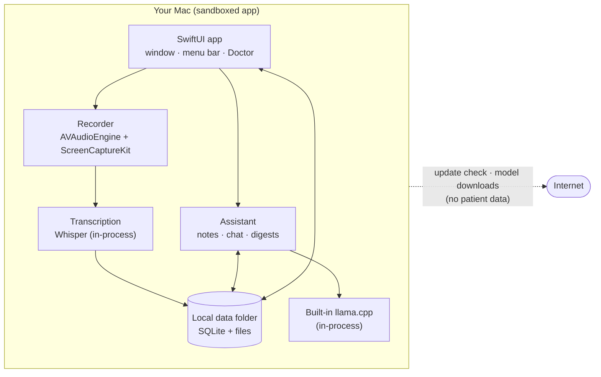
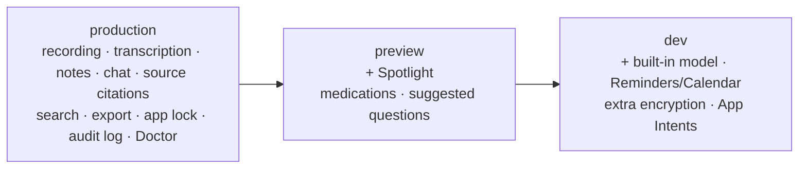
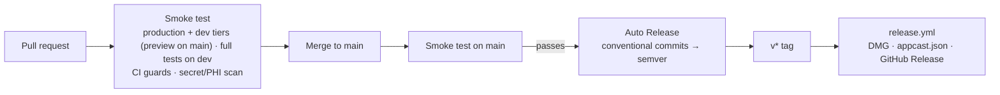

# Aletheia

**Session notes for therapists, written on your Mac and kept on your Mac.**

Aletheia records a video-call therapy session, transcribes it, drafts a progress note, and lets you search and ask questions across a patient's history. The speech recognition and the AI both run on your computer. Patient data is never sent to a server, and there is no analytics or telemetry.

[For therapists](#for-therapists) · [How it works](#how-it-works) · [For developers](#for-developers) · [Setup guide](docs/SETUP-GUIDE.md) · [Security](SECURITY.md) · [Changelog](CHANGELOG.md)

> **License:** source-available, not open source. All rights reserved; see [LICENSE](LICENSE), [Terms](TERMS.md) and [Privacy](PRIVACY.md).

---

### Privacy First

- No patient content leaves the Mac. Recording, transcription, notes and chat are all local.
- The app makes a few requests that carry no patient data: a check for new versions (a plain download of a small file from GitHub), and downloads of the speech and AI models you choose to install.
- The app runs in the macOS App Sandbox and spawns no subprocesses. Its only network entitlement is outbound client connections.
- Raw audio is deleted after transcription unless you opt in to keeping it and encryption is on.
- Apple Intelligence is deliberately disabled so every AI path is provably on-device.
- The app has no backup feature of its own. Time Machine includes the data folder by default. See [docs/DATA-SAFETY.md](docs/DATA-SAFETY.md).

Aletheia is a tool, not legal or clinical advice. Read [CONSENT.md](CONSENT.md) before recording anyone.

---

## For therapists

You need a Mac running **macOS 14 or newer**, and 4 to 8 GB of free disk space for the downloads. Apple Silicon with 16 GB of memory gives the best results; 8 GB works with smaller models, which the app picks for you.

### 1. Install Aletheia

Download the latest `Aletheia-<version>.dmg` from the [Releases page](https://github.com/mgwedd/aletheia/releases), open it, and drag **Aletheia** into **Applications**.

The app is not notarized by Apple, so macOS will hesitate. **Right-click Aletheia, choose Open,** then confirm. You only do this once.

### 2. Set up with the checklist

On first launch Aletheia shows a checklist. Work down it:

1. **Data folder:** click **Choose Folder…** and pick where everything is stored (iCloud Drive or any folder you back up).
2. **Microphone:** click **Allow Microphone**.
3. **Call audio capture:** click **Allow**. macOS calls this "Screen Recording", but Aletheia only uses it to hear your video call. It does not capture the screen.
4. **Transcription model:** click **Download**.
5. **AI model:** click **Download**. Aletheia fetches the model that fits your Mac (3–6 GB, once) and runs it inside the app. Nothing else to install. Wait for the row to turn green.
6. **Terms & Privacy:** read and accept.

After the downloads, Aletheia works offline. If a row will not turn green, see the [Setup guide](docs/SETUP-GUIDE.md).

### 3. Your first session

1. Click **Add Patient** (the + button) and enter a name.
2. Click **New session**.
3. Open your video call as usual, then click **Record Session** (or use the menu bar icon).
4. Click **Stop** when finished. Transcription starts by itself if **Settings → General → Transcribe automatically when a recording ends** is on; otherwise click **Transcribe**.
5. Open the **Notes** tab to jot your own notes and generate the progress note. Choose the format (narrative, SOAP, DAP, BIRP or GIRP) under **Settings → Note format**. Use the **Length** menu to make it shorter or longer, then **Regenerate** to apply. **Edit** it, then **Copy** to paste into your record (formatting is kept), or **Export** it as a PDF, Word or Markdown file. **Export** on the session saves the note and transcript together. On the patient page, **Export all records** builds a zip of the whole history in the background. ⌘S saves your edits and ⌘G generates or regenerates the note.
6. Use the **Ask** tab to question this session, or **Ask about this patient** on the patient page. Answers say what was read.
7. The **Search all patients** field at the foot of the sidebar (⌘F, wherever the cursor is; ⌥⌘F finds within the open transcript or note) searches patients, sessions, your notes, progress notes, comments and transcripts. Results appear in one grouped list; use the arrow keys to move and Return to open. **Help → Keyboard Shortcuts** (⌘/) lists every shortcut.

Always read the transcript and note before relying on them. Names and clinical terms are often misheard, and AI drafts can be wrong.

If something looks wrong, open **Help → Aletheia Doctor…** for a health report that contains no patient information.

---

## How it works

### System overview



### What a note or answer reads

- **Context window.** The prompt is never truncated silently. Each Mac has a prompt budget: 16K tokens on 8 GB, 32K on 16 GB, 64K on 32 GB or more (one tier lower on Intel). A prompt over budget fails with a clear message and nothing is sent.
- **Token estimate.** The budget check counts by script: about 3 Latin characters a token, but about a token per character for Japanese, Chinese, Korean and similar scripts.
- **Tripwire.** If the engine reports reading well under what was sent, or reading right up to its window's limit, the answer shows a notice that the model may not have read everything.
- **Progress.** A note shows one line and a progress bar while it is generated; chat shows the stage, elapsed time and token counts.
- **Chat memory.** Past about 12,000 characters, older messages are replaced by a summary (also `/compact [focus]`). Source material is always sent fresh.
- **One session** chat sends the session's transcript.
- **Patient-wide chat** is sized from the Mac's budget less the instructions, conversation and question. Background, notes and comments (newest sessions first, up to a third of the room) come first; transcripts take the rest. If the transcripts fit, they go in whole, newest first. Otherwise the history is read by zoom level (`PatientZoom`): stored session summaries (newest first, older ones merged by month), then a search over every transcript for the question's names and words, then the summaries of the parts of sessions the hits fall in plus the transcript lines around the best hits. No transcript goes in whole. When search finds no lines to quote, the room kept for sessions with no summary yet goes to the openings of their transcripts. At Normal or Focus effort the model can also ask to read a transcript part in full. If too little room is left, the question is refused rather than cut.

The search (`SessionSearch`) reads a persistent SQLite FTS5 index (`search.sqlite` in the data folder), keyed by content fingerprint and rebuilt if missing:

- BM25 ranking over passages (a transcript line or a paragraph of notes);
- whole-word matching with a stemmer, one-letter typo tolerance, and sound-alike matching for names, because Whisper misspells them;
- quoted phrases match exactly; date phrases such as "past 6 months" narrow the sessions searched;
- exact counts ("14 mentions in 6 of 22 sessions"), and the model may say a topic was not discussed only when the search found nothing, worded "no match found".

Each patient-wide answer carries a coverage label built from what was actually sent, for example `Read: notes and comments from 22 sessions · transcript passages from 6 of 22 sessions (search: 14 mentions)`; on a long history it also names the summaries and transcript openings that were read. Sessions whose notes were cut short or left out, and unreadable sessions, are reported as such. There is no click-through from a search hit to a transcript moment.

### Session digests

A digest is an AI-written summary of one session, stored as `digest.json` beside its notes and never shown as the record. It is built in the background, at low priority behind notes and chat, after a transcription finishes or a transcript edit is saved.

- The transcript is split into sections of about ten minutes (cut sooner at 12,000 characters). Each section gets a digest of topics, the patient's key statements, interventions, affect, risk flags and follow-ups, tied to its time range. The sections are then merged into one session digest of at most about 2,000 characters.
- A digest is valid only for the transcript fingerprint, model and prompt version it was built from; otherwise it is ignored and rebuilt at the next trigger.
- Progress shows as one line on the session ("Building digest · section 4 of 11"). A failed or cancelled build is retried at the next trigger. Finished section summaries are kept, so a build that is paused, quit, or taken over by a note or chat answer resumes from them.
- A background scheduler also prepares missing summaries, newest session first, only while nothing else is using the model. It pauses while locked, recording, transcribing or busy, in Low Power Mode, and on battery unless **Prepare summaries on battery** is on in Settings. The patient page shows its status with Pause, Resume and Prepare now.
- Digests are sealed like transcripts when encryption is on. Notes and chat read transcripts, not digests.

### Where data lives

```
<data folder>/
  .aletheia.json                  schema version stamp
  Aletheia.sqlite                 notes, comments and chat threads
  audit.log                       PHI-free event log
  .aletheia-keystore.json         only when encryption is on
  .backups/{migrations,snapshots,archives}/
  Patients/<Patient-Slug>/
    patient.json
    YYYY-MM-DD_Session/
      session.json  mic.caf  call.caf  transcript.txt  summary.txt
      note.<format>.txt  digest.json
```

`mic.caf` and `call.caf` are deleted after transcription by default. Schema changes are append-only migrations, with a pre-migration copy of the database in `.backups/migrations`. The SQLite file is a single `records` table of `(kind, id, owner, item, payload)`.

The encrypted archive service covers only the SQLite database and is not invoked from the app. Transcripts, notes and digests are backed up only through the data folder itself (for example Time Machine). The app has no delete-session action.

### Transcription

- [whisper.cpp](https://github.com/ggml-org/whisper.cpp) v1.9.5 runs in-process on the GPU via Metal.
- Silero VAD v6.2.0 skips silence so long pauses cannot trigger repeated phantom lines.
- Microphone ("You") and call audio ("Call audio") are captured as separate tracks and merged by timestamp.

The only third-party dependencies are the official whisper.cpp and llama.cpp XCFrameworks (ggml-org, pinned by checksum). The Silero model is MIT-licensed, under 1 MB, pinned by SHA-256. A sandboxed native app can capture call audio with ScreenCaptureKit and run Whisper in-process, which keeps the privacy boundary small enough to audit.

### AI backends and recommended models

- **Built-in llama.cpp** is the default runtime, in-process. See [Embedded llama.cpp](#embedded-llamacpp).
- **Apple Intelligence** is disabled via `Integrations.appleIntelligenceBlocked = true`.

`ModelAdvisor` picks defaults from your hardware:

| Mac | Speech model | AI model |
|---|---|---|
| Apple Silicon, 16 GB+ | medium.en | llama3.1:8b |
| Apple Silicon, 8 GB+ | small.en | llama3.2:3b |
| Intel, 16 GB+ | small.en | llama3.1:8b |
| Other, 8 GB+ | base.en | llama3.2:3b |
| Under 8 GB | base.en | llama3.2:1b |

### Storage protection

- **Sandbox, lock, audit:** App Sandbox is on; the optional app lock uses LocalAuthentication; the audit log records events (unlock, encryption changes, export) without content; deletions are not recorded.
- **Encryption (dev tier only):** AES-256-GCM in 1 MiB chunks, with a random data key wrapped by a passphrase (PBKDF2-HMAC-SHA256, 600,000 iterations). See [docs/ENCRYPTION.md](docs/ENCRYPTION.md).
- **Backups:** rolling database snapshots and pre-migration copies are kept in `.backups`. Time Machine is the supported backup.

### Build tiers

Features are grouped into tiers chosen at compile time. Each includes the one before it; the released DMG is **production**.



Debug builds are `dev`; Release builds are `production`. Tiers are set by `ALETHEIA_PREVIEW` and `ALETHEIA_DEV` compilation conditions in `project.yml`.

---

## For developers

### Prerequisites

- A Mac with full **Xcode 16+**
- [XcodeGen](https://github.com/yonaskolb/XcodeGen): `brew install xcodegen`

There is no checked-in `.xcodeproj`. `project.yml` is the source of truth.

### Build and test

```bash
git clone https://github.com/mgwedd/aletheia.git && cd aletheia
./scripts/build.sh            # generates the project, Release build, ad-hoc signed → dist/Aletheia.app
xcodegen generate && open Aletheia.xcodeproj    # or work in Xcode
xcodebuild test -scheme Aletheia -destination 'platform=macOS'
```

To test a specific tier, pass `SWIFT_ACTIVE_COMPILATION_CONDITIONS` to `xcodebuild`: `"DEBUG"` (production), `"DEBUG ALETHEIA_PREVIEW"` or `"DEBUG ALETHEIA_PREVIEW ALETHEIA_DEV"`. The root `Package.swift` also supports `swift test`, always at the dev tier.

### Repository map

```
Sources/App/
  AletheiaApp.swift       entry point: main window, Doctor, Settings, menu bar
  Models/                 Patient, SessionRecord, ChatThread, …
  Views/                  SwiftUI views
  Services/               recorder, transcriber, assistant, store, app lock, settings
    Digest/               section splitting and background digest builder
    Search/               BM25 search over a persistent FTS5 index
    Persistence/          SQLite core, schema migrator, migration backup
    Repositories/         annotation and chat repositories
    Crypto/               encryption, keystore, snapshots, backup
    Integrations/         assistant/transcriber factory, backend selection
    Features/             build tiers, feature registry, Doctor
    Llama/                embedded llama.cpp backend
Tests/AletheiaTests/      XCTest suite
scripts/                  build, release, secret scan, entitlement, pin and CI-gating checks
docs/                     setup, data safety, encryption, HIPAA safeguards
```

### Continuous integration



CI runs on macOS runners (the only place the Swift code compiles). To save macOS time, a pull request builds the production and dev tiers only (preview is built on pushes to `main` and on a manual run); production and preview run only the tier-sensitive tests while dev runs the full suite, and the packaging job (`cd.yml`) runs on a pull request only when packaging inputs change. The path check is `scripts/ci-changes.sh`, applied as a job-level `if:` so a skipped job still reports success to branch protection; `scripts/check-ci-gating.sh` guards that wiring. The benchmarks workflow runs only when started by hand. `main` also requires CodeQL code-scanning results (GitHub's default setup, for the workflows and Python only). Developer ID signing and notarization run only when signing secrets are configured; otherwise the DMG is ad-hoc signed. Model downloads are pinned by commit and SHA-256, checked weekly by `verify-model-pins`.

### Conventions

- **Conventional Commits** drive releases: `feat` → minor; `fix`, `perf`, `revert` → patch; `!` or `BREAKING CHANGE` → major; everything else → no release. Squash-merge with the PR title as the subject.
- **`CHANGELOG.md` is generated.** Do not edit it by hand.
- **Privacy invariants:** PHI never leaves the Mac; no analytics; the only outbound calls are the update check and opt-in model downloads. Apple Intelligence stays disabled.
- **Dependencies:** first-party and pinned. GitHub Actions are first-party only.
- **Settings** follow the `AppSettings` pattern: UserDefaults-backed, `private enum Keys`, values loaded in `init`.
- **Colors** come from `Theme` (`Sources/App/Views/Theme`); no color literals in screens.
- Enable the pre-commit hook: `git config core.hooksPath scripts/hooks`. It runs `scripts/scan-secrets.sh`, a fail-closed check for secrets and PHI-like filenames.

### Embedded llama.cpp

The official llama.cpp XCFramework (`Packages/LlamaCpp`, pinned by URL and checksum) is linked into every build. The built-in model is the default AI engine in every build: setup downloads it inside Aletheia, with nothing else to install.

Models come from ggml-org on Hugging Face, pinned to a revision and verified by SHA-256 before install:

| Mac | Default model |
|---|---|
| 16 GB+ | Llama 3.1 8B Instruct Q4_0 (~6.0 GB) |
| Under 16 GB | Gemma 4 E2B Q4_0 (~2.8 GB) |

The engine applies the model's chat template. The context is sized to the prompt plus the reply, rounded up to a power of two (8K minimum) and capped at the context budget and the model's limit; a prompt over budget fails rather than being truncated. Flash attention and an 8-bit KV cache are on. The model unloads on app lock, on a model or backend change, and after 30 minutes idle.

### Releases

Merging to `main` is enough once Smoke Test passes on the merge commit: Auto Release then computes the version, updates the changelog and tags it. It runs in the `release` environment and pushes the release commit and tag with the `RELEASE_DEPLOY_KEY` deploy key (which is on the branch ruleset's bypass list); the tag push starts `release.yml`. Only when that secret is unset does Auto Release dispatch `release.yml` explicitly. A failed or cancelled run releases nothing, and if `main` has moved on, the newer commit's run releases the whole range. A manual release can be dispatched from the Actions tab.

---

## Known limitations

- The Swift code compiles only on macOS CI; recording and transcription on real hardware need manual verification before each release.
- Mic and call tracks are not sample-accurate with each other, so interleaved lines can be off by a short interval.
- Patient-wide chat on a long history reads summaries and search passages, not every transcript; sessions with no summary yet may be represented only by their opening.
- A session longer than the Mac's prompt budget cannot be summarized in one pass.
- No CoreML encoder is bundled; transcription uses CPU/Metal.
- Encryption is in the dev tier only, and release builds are notarized only when signing secrets are configured.
