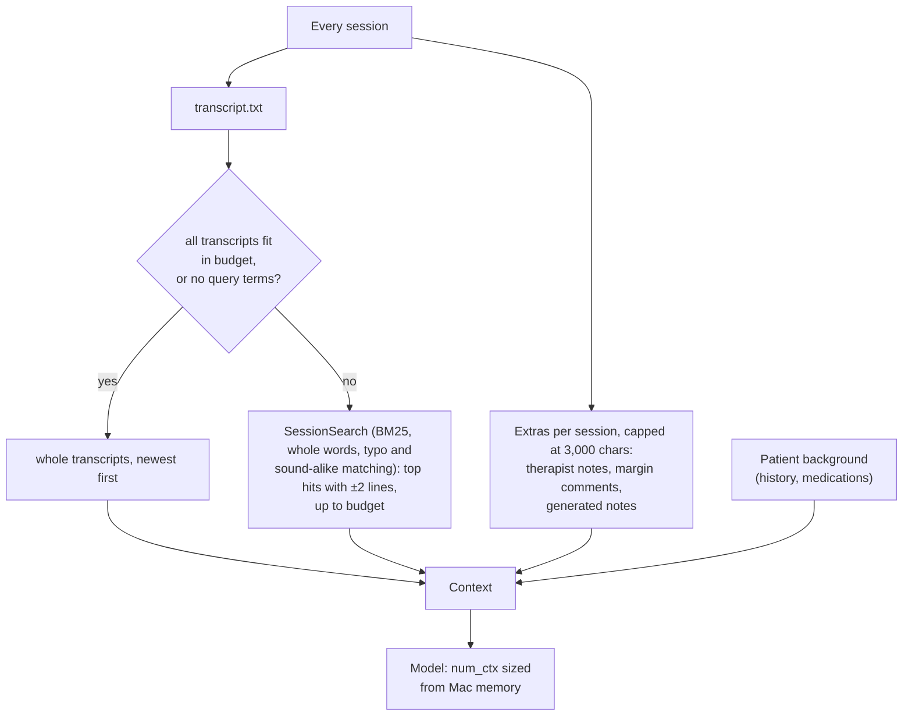
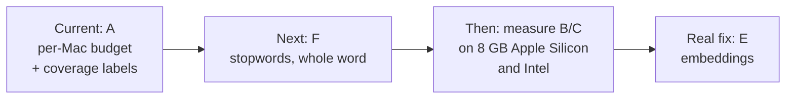
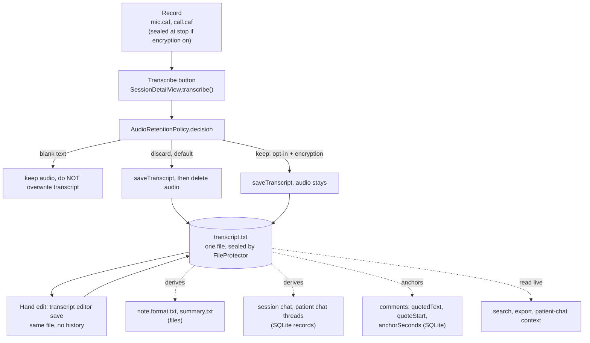
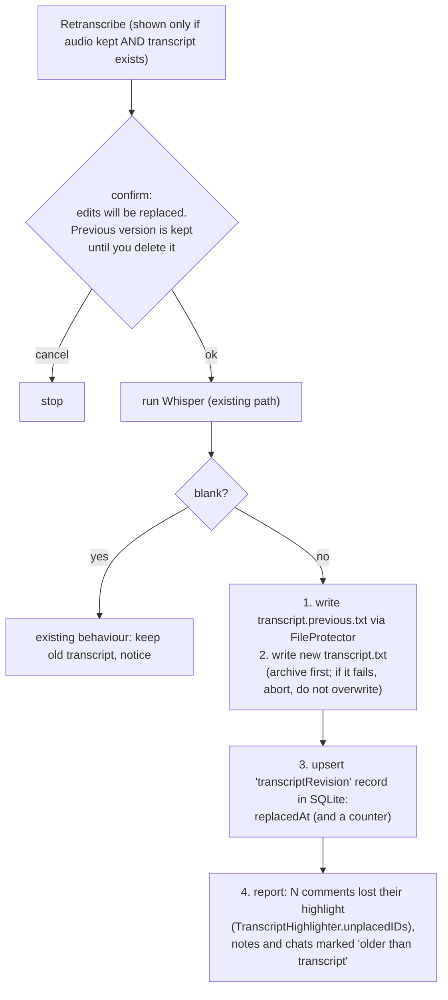

# Design decisions

Open decisions that need an owner call. Each section states what the code does
today (checked against `main`), the options, a recommendation, and what is
needed from the owner.

- [1. Patient-wide chat context budget](#1-patient-wide-chat-context-budget)
- [2. Retranscribe a session](#2-retranscribe-a-session)

---

## 1. Patient-wide chat context budget

### What the chat sees today

| Part | Limit | Source |
|---|---|---|
| Transcript text, all sessions together | Mac-dependent: 16K tokens on 8 GB, 32K on 16 GB, 64K on 32 GB+ (Intel one tier lower) | `ModelAdvisor.contextBudgetTokens` |
| Characters per token | ~3 characters | `ContextBudget.charactersPerToken` |
| Extras per session (notes, comments, generated notes) | 3,000 chars, ordered therapist words first | `Store.patientChatSessionExtrasLimit` |
| Patient background | none | `Patient.aiBackgroundBlock` |
| Total prompt | 10% headroom kept to allow budget margin | `ContextBudget.availableCharacters` |
| Model context window | sized to prompt per budget | `ContextBudget.neededTokens` |

**Since this analysis:** when the transcripts do not fit, the chat no longer
sends only the top search hits. It reads the history by zoom level
(`PatientZoom`): stored session summaries (digests) first, then search over
every transcript to find the parts of sessions that matter, their summaries,
and the lines around the best hits. A transcript part is read in full only when
the model asks (`read_section`, at Normal or Focus effort). The diagram above is
the search-only path; option D's per-session summaries now exist as digests,
built in the background. Token estimates are now by script (`ContextBudget`),
not a flat 3 characters per token.

An hour of speech is tens of thousands of characters, so a long history is cut
to a small fraction of the transcript text. Ranking is TF-IDF over substring
matches (`TextSearch.queryTerms` keeps every word, no stopword filter), so a
vague question matches weakly and ranks poorly.

**Prompt is sized to the Mac.** The budget covers transcript text only. Extras
add up to 3,000 chars for each session, so 20 sessions can add about 60,000
chars (about 20,000 tokens), which exceeds the smallest Mac's budget. The built-in
engine sizes its context (`n_ctx`) from the tokenized prompt, capped by the Mac's
memory and the model's trained window, and refuses over-budget prompts with a
clear message, so nothing is truncated silently.

### Implementation notes

- The chat sheet subtitle discloses the budget constraint instead of claiming it
  "searches every session's transcript".
- After each question, a caption reports what percentage of transcript text was
  included and how many sessions had no transcript passage included
  (`TranscriptCoverage`, computed in `Store.gatherCitedPatientContext`). It is
  hidden when everything fits within budget. Notes and comments are not counted.
- Citations are already limited to sessions that appear in the context. A
  session whose only material was notes (no transcript passage) can still be
  cited; the coverage caption clarifies this.

### Options

| Option | Recall | Latency and memory | Risk | Effort |
|---|---|---|---|---|
| **A. Per-Mac dynamic budget** (current) | unchanged | none | user still gets partial-evidence answers, now with coverage labels | done |
| **B. Larger fixed budget** (e.g., 24,000 tokens) | up to 4x | KV cache and time-to-first-token grow with prompt; an 8 GB Mac can swap | the engine's cap must rise to match, and a bigger `n_ctx` rebuilds the context and its KV cache | small, but needs measurement |
| **C. Per-model dynamic budget** | scales with hardware | same as B, bounded by tier | needs a table of context sizes per model tag and per `ModelAdvisor` tier; table goes stale as models change; a model's trained window may differ from what fits in RAM | medium |
| **D. Map-reduce summaries** (summarise per session, answer over summaries) | every session represented | one model call per session, slow on 3B models; cache per session keyed on transcript hash to amortise | compounding error; a summary drops the detail a clinician asks about; a wrong "not discussed" is plausible | large |
| **E. Embeddings** (NaturalLanguage, on-device) | best for vague questions | index build once per session; query is cheap | index is PHI: must be sealed (`FileProtector`), migrated by `DataMigrator`, excluded from export and covered by backup rules | large |
| **F. Lexical fixes** (stopwords, whole-word match) | small gain | none | low | small |

### Recommendation

1. A (per-Mac budget with coverage labels) is the current approach. It surfaces
   the partial-coverage constraint to the user clearly.
2. Do F next; it is a small, test-covered change in `TextSearch` and the
   retriever to improve ranking on vague questions.
3. Do B or C only after measuring memory and time-to-first-token on 8 GB
   Apple Silicon and Intel Macs. If done, derive the budget from `num_ctx`
   explicitly (C), not a fixed constant (B). Do not raise the budget without
   setting `num_ctx`.
4. Skip D: it is slow on the small models `ModelAdvisor` picks for 8 GB Macs,
   and its failure mode (confident summary that omits the detail) is the core
   problem to avoid.
5. Treat E (embeddings) as the real fix for vague cross-session questions.

### Open questions

1. Is the coverage caption enough, or should over-budget questions block answers
   with "I could not read the full record" instead of searching?
2. Should the minimum supported Mac for multi-session chat be 8 GB Apple
   Silicon, 8 GB Intel, or 16 GB across the board?
3. For vague questions, does reducing latency (smaller context) or improving
   recall (larger context) matter more to your workflow?
4. Should per-Mac budgets be bounded by a lower limit, e.g., never below 8K
   tokens, even on under-8GB hardware?

---

## 2. Retranscribe a session

This records what would break and the smallest safe design if a retranscribe
feature is built. No code changes currently.

### Current data flow

### An existing hazard, independent of this feature

`Transcribe` is enabled whenever `mic.caf` or `call.caf` exists
(`hasAnyRecording`), with no check for an existing transcript and no
confirmation. Whenever audio is retained (opt-in with encryption, or kept
because the first transcript was blank), tapping Transcribe again already
overwrites `transcript.txt` through `saveTranscript` with no history. Hand
edits and any deliberate removal of identifying text are lost silently. A
retranscribe feature would formalise this path, so fix the silent overwrite
first.

### What is keyed to the transcript

| Artifact | Where | How it depends on the transcript | Effect of a replaced transcript |
|---|---|---|---|
| Hand edits and removals | `transcript.txt` | the file itself | lost; Whisper output returns, including text the user removed |
| Comment highlight | SQLite `comment` records (`quotedText`, `quoteStart`) | `TranscriptHighlighter.resolve` re-verifies the quote; falls back to nearest occurrence, or unique match for legacy comments | safe: unmatched comments render unanchored (`unplacedIDs`), none are deleted or mis-anchored. Comment text is kept, the highlight is gone |
| Comment time anchor | `anchorSeconds` | set once from `[MM:SS]` at creation, never recomputed | stale: Whisper timestamps shift between runs or models, so rail ordering and time labels drift |
| Generated notes | `note.<format>.txt`, `summary.txt` | produced from the old text, no revision recorded | stale, indistinguishable from a note on the new text |
| Therapist notes | SQLite `note` record | free text; independent of transcript | unaffected |
| Session chat | SQLite `sessionChat` | answers quote the old transcript | stale answers remain, unlabelled |
| Patient chat threads | SQLite `chatThread` | stored answers already decorated with session dates and a Sources footer (`Citations.decorate`); tags `S1..` are per question, not stable ids | stale text; no pointer into the transcript to break |
| Patient-chat search | persistent FTS5 index `search.sqlite` (`SearchIndex`), keyed by session, kind and a fingerprint of the text | the text each search reads | not stale: a search stores any text it hasn't seen and drops older versions of that session; `saveTranscript` and a launch/unlock sweep (by mtime and size) also refresh it. It holds a plaintext (stemmed) copy of searchable text, accepted because FileVault covers it at rest; it is excluded from Time Machine and rebuilt if missing or corrupt |
| Session search, export | read from files at query time (`searchSessions`) | live | not stale |
| Spotlight | names and dates only | none | unaffected |
| Encryption sealing | `FileProtector.write` seals each write | `saveTranscript` seals correctly | a **new** file kind (such as a prior revision) is not covered: `DataMigrator` converts only a fixed list (`transcript.txt`, `summary.txt`, `chat.json`, the digest files, `note.*.txt`). A revision file left out of that list is skipped on enable (stays plaintext) and, worse, stays sealed when encryption is turned off after the keystore is removed (unreadable) |
| DB snapshots and backups | `.backups/snapshots` cover SQLite only | `transcript.txt` is a file | a replaced transcript is not recoverable from DB snapshots; only Time Machine or a manual copy |
| Whisper model | `WhisperModel` pinned by SHA | a different model gives different text and timing | every item above changes more, not less |
| Audio retention | `AudioRetentionPolicy` | audio is deleted after the first non-blank transcript by default | in the default case there is nothing to retranscribe |

### Constraints that shape any design

- **Redaction vs. history.** If a user removed identifying text by hand, a
  stored prior revision keeps that text. It must be sealed, visible in the UI,
  and deletable on demand. Retained audio already holds the spoken original, so
  hand edits are not a security redaction while audio is kept; the UI should
  not imply otherwise.
- **PHI never leaves the Mac**; revisions are extra PHI on disk and must follow
  the same sealing, migration, export and deletion rules as `transcript.txt`.
- **No `.xcodeproj` or schema churn**: SQLite `records` is generic
  `(kind, id, owner, item, payload)`; a new record kind needs no migration.

### Options, best first

| # | Option | Safety | Cost | Notes |
|---|---|---|---|---|
| 1 | **Do not build; guard the existing overwrite** | highest | tiny | confirm before Transcribe replaces a non-empty transcript; no history |
| 2 | **Single previous revision + confirm + stale markers** (recommended if built) | high | small to medium | one sealed `transcript.previous.txt`, replaced each time |
| 3 | Numbered revisions with restore and diff | high | medium to large | retention growth, delete UI, more `DataMigrator` surface, export rules |
| 4 | Retranscribe into an alternate transcript, user picks per passage | highest fidelity | large | merge UI; comments need a choice of anchor transcript |
| 5 | Silent overwrite (status quo with retained audio) | lowest | none | reject |

### Recommended minimal safe design

Steps and constraints:

1. **Gate the button.** Label it Retranscribe, enabled only when audio exists
   and a transcript exists; a first Transcribe stays as it is.
2. **Archive before replacing.** Write `transcript.previous.txt` through
   `FileProtector` first; abort without touching `transcript.txt` if that
   write fails. Single slot: a second retranscribe replaces the previous slot,
   and the confirm dialog says so when a slot already exists.
3. **Confirm with specifics.** Say that hand edits (and any removed text) will
   come back from the audio, and where the previous version is kept.
4. **Cover the new file kind.** Add `transcript.previous.txt` to
   `DataMigrator.sessionFileNames`, with a test that enable and disable both
   convert it. Exclude it from `MarkdownExporter`, search and chat context. Add
   a "Delete previous version" action; deleting the session folder already
   removes it.
5. **Comments.** Do not delete or edit them. Re-match through the existing
   `TranscriptHighlighter`, count unplaced ones with `unplacedIDs`, and show
   "N comments no longer match the new text". Recomputing `anchorSeconds` for
   re-matched comments needs a repository update method that does not exist
   (`AnnotationRepository` edits body only); leave it out of the first cut and
   say time labels may be off.
6. **Staleness without a schema.** Store one `transcriptRevision` record per
   session (`replacedAt`). A generated note is "older than the transcript"
   when its file modification date precedes `replacedAt`; chat messages carry
   `ChatMessage.date` and compare directly. Show a one-line badge on the note
   and in chat; do not rewrite or delete them.
7. **Audit.** Optional: add an `AuditAction` case for "transcript replaced".
8. **Tests** (XCTest, run in CI): archive-then-write ordering and failure
   abort; blank result leaves transcript untouched; migrator round trip for the
   new file; comment re-match count; staleness comparison as a pure function.

Not recommended: an automatic retranscribe on model change, bulk retranscribe,
and any path that overwrites without the previous-version write succeeding.

### Open questions

1. Build a full retranscribe feature, or implement option 1 (confirm before
   overwrite) only? Option 1 is recommended either way as a safety fix.
2. Accept keeping one previous revision as extra sealed PHI, with an explicit
   delete action? The alternative (no history) repeats the silent-loss problem.
3. If building the feature, is it acceptable that `anchorSeconds` on comments
   may be stale after a retranscribe, leaving time labels potentially off?
