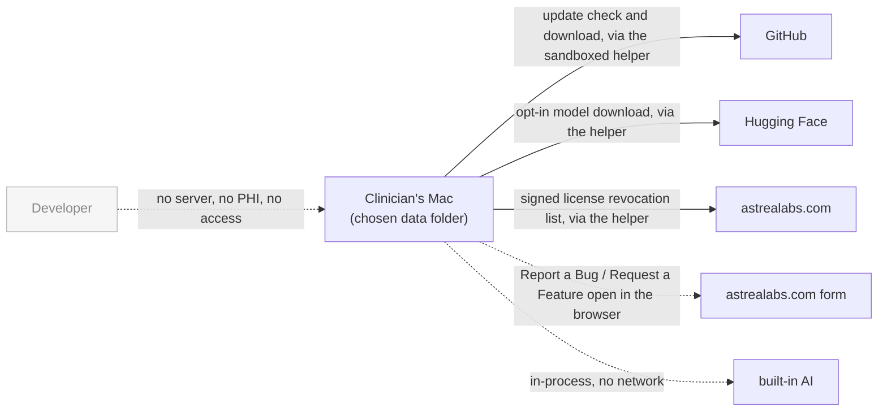

# HIPAA safeguards mapping

How Aletheia's design and features map to the HIPAA Security Rule
(45 CFR §164.308–312). This is an engineering reference, **not legal advice** and
not a certification. Meeting HIPAA is a property of a *practice* — its
policies, agreements, and workforce — not of any single application. Aletheia is
built to make the technical part straightforward and to stay out of the way of
the administrative part. Have your own counsel and your licensure/state
record-keeping rules reviewed before relying on any of this.

## Why the practice's technical surface is small

Aletheia is a **single-user** application. PHI (session audio,
transcripts, summaries, notes, comments, session digests) is created and stored
in a data folder on the clinician's Mac. The App defaults to its standard
location and refuses folders in iCloud Drive or other cloud-synced locations,
network locations and unencrypted removable drives.
Astrea Labs runs **no servers,
accounts, analytics, or telemetry** and never receives, transmits, stores, or can
access any of that data.

Because Astrea Labs LLC never receives PHI, it is **not a business
associate** for the app itself, and no Business Associate Agreement (BAA) is
required for the app (see [PRIVACY.md](../PRIVACY.md)). The clinician/practice is
the covered entity (where HIPAA applies to the practice) and data controller. That shifts most of HIPAA onto
administrative and physical safeguards the practice owns; the app's job is the
**technical safeguards** below, plus making the practice's documentation easy.

## Data flow & local asset inventory

Use this inventory when documenting the practice's Security Risk Analysis.
Paths are relative to the data folder selected at first run; the App defaults to
its standard location and refuses synced, network and unencrypted removable folders. Confirm the chosen folder and
the destination and encryption of any system backup.

| Asset | Location and handling |
| --- | --- |
| Patient and session files | `Patients/<patient folder>/<session folder>/` contains `patient.json`, `session.json`, audio (`mic.caf`, `call.caf`), transcripts, summaries, generated notes, digests, and chats. Patient folder names and session folder names can reveal identifying information. `consent.json` in each session folder records the recording consent. These files are plaintext unless optional at-rest encryption was enabled in a developer build or an earlier build. |
| Clinical database | `Aletheia.sqlite` holds records, metadata, and the audit ledger. The optional encryption feature seals selected fields, not the SQLite file, schema, or all metadata. |
| Search index | `search.sqlite` is a local full-text index of transcript, note, and comment text. It is plaintext even when optional encryption is on, and it stays on disk between launches; the app lock closes it but does not delete it. It is deleted when encryption is turned off and rebuilt when missing. It sits in the data folder, so it follows the folder's backup exclusion setting and nothing more. |
| Audit log | The `audit_events` table in `Aletheia.sqlite` is an append-only, HMAC-chained ledger of actions, times, the macOS account name and user ID, and optional opaque identifiers. It is not encrypted by the optional encryption feature. An old `audit.log` text file is imported once and renamed `audit.log.imported`. |
| Recovery material and copies | `.aletheia-keystore.json` stores a wrapped data key if optional encryption is enabled. `.backups/snapshots/` and `.backups/migrations/` hold local safety copies; the five newest database snapshots are kept, including the one taken just before a patient is deleted, so a deleted patient can remain in them. Back Up Now writes an encrypted archive of the whole data folder (`.aletheiabackup`) to a folder the user picks, but it needs at-rest encryption, which is developer builds only, so it is not available in released builds. Where it is available it refuses synced, network and unencrypted removable destinations, never uploads, and each successful run is recorded once in the audit ledger. Restore from backup unpacks into a new, empty folder only, verifies integrity before writing anything, and is recorded once in the ledger. |
| Other local storage | App settings and the selected-folder bookmark live in the macOS app container. Downloaded models live under the app's Application Support directory. While a recording is in progress its audio is staged in a private (`0700`) `Staging/` folder in the same Application Support directory, then moved into the session folder when it stops (sealed if encryption is on); a crash leaves it there until the next launch recovers it. Optional remembered data keys use the device-only login Keychain service `com.aletheia.datakey`; the audit ledger's signing key is a separate login Keychain item. |
| Exports | Settings › Backups › Export All Records writes a folder of ordinary, unencrypted files (a `Read me.txt` plus one folder per patient) to a location the user picks, and records the export in the audit ledger. It leaves out psychotherapy notes and private comments, which are exported on their own from the patient or session. Single-note and session exports can be Word documents as well as PDF and text. The app warns when the destination is on an unencrypted disk or a synced folder. The practice owns that copy and decides what minimum necessary means for each disclosure. |

The app itself has no network entitlement. Its bundled, sandboxed network helper
(which has no file access) checks the GitHub release appcast when update checks
are enabled, downloads the release disk image when the user chooses to install
an update, downloads models from Hugging Face when requested, and fetches a signed license revocation list from astrealabs.com at most daily while update checks are on, with no identifier. The app names
each download by a fixed number, never a web address. The built-in AI runs
in-process and makes no network requests. The Report a Bug and Request a Feature
commands open a form on astrealabs.com in the browser, with only the project,
report type, and the app, macOS and chip versions in the link; reports filed through them can be public GitHub issues, so they must never contain patient information. The helper sends the default macOS URLSession User-Agent, and the hosts see the Mac's IP address like any web request. These network
requests are separate from the data folder. A synced data folder can transmit
its contents through the user's cloud provider outside the app's own network
requests. The app does not upload backups of its own.

## Technical safeguards — §164.312

Legend: **✅ in place** · **◐ in progress** · **○ clinician responsibility (app assists)**

| Safeguard (§164.312) | Status | How Aletheia addresses it |
| --- | --- | --- |
| **Access control (a)(1)** — unique user ID, limit access to authorized users | ✅ / ○ | The app has no accounts of its own. Single-user app scoped to one macOS account; the macOS login (unique user, password/Touch ID) is the access boundary, and the app adds its own lock below. Sharing one macOS account between people defeats unique identification, and the audit log would record them as the same user. |
| **Emergency access procedure (a)(2)(ii)** *(required)* | ○ / ✅ | In released builds the app has no encryption of its own to recover, so emergency access rests on the macOS account and the FileVault recovery key, both held by the practice. In developer builds with at-rest encryption, a 24-word BIP-39 emergency recovery key (≥256 bits entropy) is generated when at-rest encryption is enabled and can be replaced at any time in Settings › Encryption. It wraps the data encryption key (DEK) in an independent keyslot. Clinicians are guided to print or export the key as a PDF during setup and store it in an offline, physically secured location (e.g. a locked safe or deposit box). Emergency access is executed by clicking "Use recovery key…" on the folder unlock screen. The recovery key is never written to disk in the data folder. |
| **Automatic logoff (a)(2)(iii)** *(addressable)* | ✅ / ○ | App lock (on by default) re-engages whenever the Mac locks or sleeps, its display sleeps, or the user switches, and the in-app idle lock re-locks after 15 minutes of inactivity by default (adjustable or Never; hiding the app with ⌘H also locks, on by default). Every window that shows patient data is covered while locked. The Mac's own screen-lock setting (System Settings › Lock Screen) remains the practice's control. |
| **Encryption & decryption (a)(2)(iv)** *(addressable)* | ◐ / ○ | FileVault is the disk-level control the app relies on: it reads whether the data folder's disk is encrypted and will not add new patients, sessions or recordings while it is known to be unencrypted (existing records stay readable and exportable). The optional AES-256-GCM at-rest feature is currently available in developer builds only, not production; see [ENCRYPTION.md](ENCRYPTION.md). Production users should use FileVault and encrypted backup media. The Security Rule's encryption specification is addressable, and the practice decides and documents whether FileVault meets it. |
| **Audit controls (b)** — record and examine activity involving ePHI | ◐ | An append-only, tamper-evident ledger in `Aletheia.sqlite` records app unlocks, failed unlocks and locks; encryption turned on, off or unlocked; exports of a session, a note, a patient, or all records; patient and session creation; saves of a transcript, a note, a therapist note or a comment; signing a note and the check that an AI note was reviewed; recording-consent attestations; changes to security settings, the data folder and the encryption key; failed exports and failed integrity checks, and repeated failed unlocks; deletions of a patient, a recording, a chat or a comment, and of set-aside recordings; opening a patient or session (at most once per record every few minutes); the kind of AI work run on patient data (never the prompt or output); copying patient text to the clipboard (the kind only); changes to custom note instructions (never the text); recordings recovered after an unexpected quit; and audit-log exports. Each entry carries a time, the macOS account name and user ID, and at most an opaque record ID, with no patient names or clinical text. Rows are HMAC-SHA256 chained under a Keychain key, the database refuses edits and deletes, and Settings › Security verifies the chain and exports a report. An entry's note can only be fixed text written in the code. A row with no tag, or whose action this version doesn't know, is shown as it is stored rather than hidden. Writes are best effort. |
| **Integrity (c)(1)** — protect ePHI from improper alteration/destruction | ◐ / ○ | Signing a note stores a hash of its text, and a note changed after signing is flagged as altered. The original transcript is kept next to any edited one, and the previous note text is kept in one previous-version slot. Identity and metadata writes are atomic. The app has no amendment feature: a correction a client requests under §164.526 is made by the clinician by hand, and the app keeps no full history of every edit. Local database snapshots assist recovery, but a complete backup of the data folder remains a practice responsibility. |
| **Person/entity authentication (d)** | ✅ | App lock via `LocalAuthentication` (Touch ID or Mac password) gates access to the app; macOS account auth gates the device. |
| **Transmission security (e)(1)** — guard ePHI in transit | ◐ | The app has no network entitlement. Update checks, update downloads, opt-in model downloads and the license revocation list run in a sandboxed helper over HTTPS to GitHub, Hugging Face and astrealabs.com and carry no ePHI; the built-in AI runs in-process. The app has no working cloud-backup upload. A clinician-chosen data folder may itself be in a synced location, so select a local folder when PHI must stay on the Mac. |

Patient folders use opaque UUID names after the v2 folder migration. Session
folder names still carry dates of service. The FTS cache (`search.sqlite`)
contains searchable plaintext terms; it is protected by the FileVault gate and
by whatever protects the data folder. The app lock closes it, and it is deleted
when encryption is turned off and rebuilt when missing. The v2
migration retains a structured JSON pre-image under `.backups/migrations/files/`.
That backup and session folder names remain within the FileVault protected data
folder.

## Administrative & physical safeguards — §164.308 / §164.310

These belong to the practice. Aletheia supports, but cannot satisfy, them:

- **Risk analysis & management (§164.308(a)(1))** — this document plus the app's
  visible safeguard state help you document the technical controls in your risk
  analysis. The policy/analysis itself is yours.
- **Workforce security, sanction policy, information-access management** — org
  policy. On a shared Mac, use separate macOS accounts and enable app lock +
  a short screen-lock interval (optionally the in-app idle lock).
- **Contingency plan / data backup (§164.308(a)(7))** — the data folder is kept
  out of Time Machine and iCloud device backups by default (a Settings switch
  turns this off), and Back Up Now needs at-rest encryption, which is developer
  builds only, so a released build makes no backup for you. Arrange your own:
  turn the exclusion off and back up to an encrypted disk, or copy the folder
  yourself. The folder can hold unencrypted PHI, so use an encrypted backup
  disk. The app creates local database snapshots before selected operations
  (the five newest are kept). Where Back Up Now is available it writes an
  encrypted copy of the whole data folder to a local folder the clinician
  chooses, and refuses iCloud or other synced folders. Restore from backup
  recovers it into a new, empty folder. Test a restore before relying on a backup.
- **Facility & workstation/device controls (§164.310)** — physical security of
  the Mac is the practice's. FileVault + app lock reduce exposure if a device is
  lost or left unattended.
- **Media disposal (§164.310(d))** — disposal of the Mac and any backup or
  export media is the practice's. Deleting a patient in the app removes their
  files, but the local database snapshots, Time Machine and other backups, and
  any exports can still hold the data, and deleting files on an SSD is not a
  secure erase. Use FileVault and erase the disk, or destroy the media, when a
  device is retired.
- **Documentation retention (§164.316)** — keep your policies and risk analysis
  for six years from creation or last effective date.
- **Breach notification (§164.402)** — ePHI that is encrypted to the standard HHS
  guidance describes, with the key not compromised, is "secured" and its loss is
  not a reportable breach. Whether FileVault on a lost Mac qualifies, and
  whether the Mac was locked and the data unreadable, is the practice's
  determination. Exports, backups and copies you make are covered only if they
  are encrypted as well.
- **Psychotherapy notes and the designated record set (§164.501, §164.524)** —
  Aletheia's psychotherapy notes and private comments are kept apart and left
  out of Export All Records. Progress notes, summaries and transcripts are
  likely part of the designated record set a client can ask to see or have
  amended. Deciding what falls where is the clinician's.
- **Raw audio** — the recording is deleted once it is transcribed. If
  transcription produces no text, the audio is kept so you can retry, unencrypted
  unless folder encryption is on, until you delete it. Keeping audio after
  transcription is available only with folder encryption on, which released
  builds do not offer. Recordings recovered after an unexpected quit are
  finished at the next launch.
- **Substance use disorder records** — 42 CFR Part 2 programs have additional
  consent and disclosure rules that Aletheia does not support.

## Emergency access procedure (§164.312(a)(2)(ii)), developer-build encryption only

In released builds, use the FileVault recovery key and the macOS account instead. In a developer build with at-rest encryption on, if a clinician forgets their primary encryption passphrase, or during an emergency when authorized personnel require access to critical clinical records:

1. **Obtain the physical recovery key:** Retrieve the printed or exported 24-word emergency recovery key from the practice's physical security storage (e.g., locked fireproof safe or safety deposit box).
2. **Launch Aletheia:** Ensure the target encrypted data folder is selected.
3. **Open the recovery interface:** On the folder unlock screen, click **"Use recovery key…"**.
4. **Enter the 24 words:** Enter the 24 BIP-39 words separated by spaces. Aletheia verifies the 8-bit checksum and unseals the data encryption key (DEK).
5. **Post-recovery security:** Once unlocked, navigate to **Settings › Encryption** and click **"Create New Recovery Key…"** to invalidate the old recovery key and mint a fresh one for physical archiving.

## Retention note

Aletheia does **not** auto-delete clinical records on a timer. US clinical-record
retention is governed by state law and licensure boards (commonly several years
for adults, and for minors often *age of majority + N years*), not by HIPAA, and
deleting **too early** is the more common compliance risk. Retention and disposal
timing is a clinical/legal decision the clinician makes for their jurisdiction;
the app keeps records until the clinician removes them.

## Where these controls live in the app

- Settings › Security — app lock, idle lock, FileVault status, security posture,
  network access, and the audit log.
- Settings › Encryption — optional at-rest encryption in developer builds, and
  in any build for a folder that is already encrypted; see
  [ENCRYPTION.md](ENCRYPTION.md).
- Settings › Backups — system-backup exclusion (on by default), Back Up Now
  where available, and Export All Records.
- Settings › License key — the license and the locally recorded acceptance of
  the current Terms and Privacy Policy.

See also [SECURITY.md](../SECURITY.md) for the threat model and the
secret/PHI leak gates that keep the repository clean, and
[DATA-SAFETY.md](DATA-SAFETY.md) for key-recovery and safe-update
(versioned-migration) guidance.
