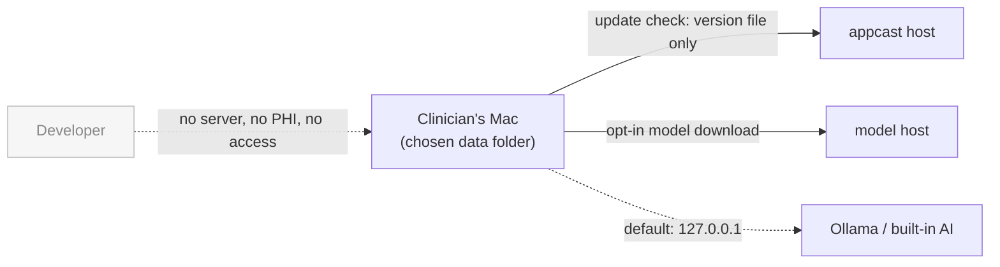

# HIPAA safeguards mapping

How Aletheia's design and features map to the HIPAA Security Rule
(45 CFR §164.308–312). This is an engineering reference, **not legal advice** and
not a certification. HIPAA compliance is a property of a *practice* — its
policies, agreements, and workforce — not of any single application. Aletheia is
built to make the technical part straightforward and to stay out of the way of
the administrative part. Have your own counsel and your licensure/state
record-keeping rules reviewed before relying on any of this.

## Why the compliance surface is small

Aletheia is a **single-user** application. PHI (session audio,
transcripts, summaries, notes, comments, session digests) is created and stored
in a data folder the clinician chooses. The folder picker opens in iCloud Drive
when it is available and suggests it, so the practice must deliberately choose a
local location to keep PHI on the Mac.
The developer runs **no servers,
accounts, analytics, or telemetry** and never receives, transmits, stores, or can
access any of that data.

Because the developer never receives PHI, the developer is **not a business
associate** for the app itself, and no Business Associate Agreement (BAA) is
required for the app (see [PRIVACY.md](../PRIVACY.md)). The clinician/practice is
the covered entity and data controller. That shifts most of HIPAA onto
administrative and physical safeguards the practice owns; the app's job is the
**technical safeguards** below, plus making the practice's documentation easy.

## Data flow & local asset inventory

Use this inventory when documenting the practice's Security Risk Analysis.
Paths are relative to the data folder selected at first run; the picker opens in
iCloud Drive when it is available, and any synced folder can be selected. Confirm the chosen folder and
the destination and encryption of any system backup.

| Asset | Location and handling |
| --- | --- |
| Patient and session files | `Patients/<patient folder>/<session folder>/` contains `patient.json`, `session.json`, audio (`mic.caf`, `call.caf`), transcripts, summaries, generated notes, digests, and chats. Patient folder names and session folder names can reveal identifying information. These files are plaintext unless optional at-rest encryption was enabled in a developer build or an earlier build. |
| Clinical database | `Aletheia.sqlite` holds records and metadata. The optional encryption feature seals selected fields, not the SQLite file, schema, or all metadata. |
| Search index | `search.sqlite` is a local full-text index of transcript, note, and comment text. It is plaintext even when optional encryption is on, and it stays on disk between launches; the app lock closes it but does not delete it. It is deleted when encryption is turned off and rebuilt when missing. |
| Audit log | `audit.log` is local JSON lines with actions, times, and optional opaque identifiers. It is plaintext, best effort, and has no tamper-evident seal. |
| Recovery material and copies | `.aletheia-keystore.json` stores a wrapped data key if optional encryption is enabled. `.backups/snapshots/` and `.backups/migrations/` hold local safety copies; the encrypted archive service is not wired into the app. |
| Other local storage | App settings and the selected-folder bookmark live in the macOS app container. Downloaded models live under the app's Application Support directory. Optional remembered data keys use the device-only login Keychain service `com.aletheia.datakey`. |

The app checks the GitHub release appcast when update checks are enabled and
downloads models from Hugging Face when requested; an Ollama model download is
fetched by Ollama from its own registry. The default Ollama endpoint
is `http://127.0.0.1:11434`; its address is configurable. These network
requests are separate from the data folder. A synced data folder can transmit
its contents through the user's cloud provider outside the app's own network
requests. The app does not upload backups of its own.

## Technical safeguards — §164.312

Legend: **✅ in place** · **◐ in progress** · **○ clinician responsibility (app assists)**

| Safeguard (§164.312) | Status | How Aletheia addresses it |
| --- | --- | --- |
| **Access control (a)(1)** — unique user ID, limit access to authorized users | ✅ / ○ | Single-user app scoped to one macOS account. The macOS login (unique user, password/Touch ID) is the access boundary; the app adds its own lock below. |
| **Automatic logoff (a)(2)(iii)** *(addressable)* | ◐ | App lock re-engages whenever the Mac locks or sleeps, so the Mac's screen-lock setting (System Settings › Lock Screen) provides the logoff; set a short interval there. An optional **in-app idle lock** (off by default) also re-locks after inactivity in Aletheia. |
| **Encryption & decryption (a)(2)(iv)** *(addressable)* | ◐ / ○ | FileVault is the recommended disk-level baseline. The optional AES-256-GCM at-rest feature is currently available in developer builds only, not production; see [ENCRYPTION.md](ENCRYPTION.md). Production users should use FileVault and encrypted backup media. |
| **Audit controls (b)** — record and examine activity involving ePHI | ◐ | A local JSON-lines `audit.log` records app unlocks and failed unlocks, encryption changes, exports, and patient deletions, with timestamps and no patient names or clinical text. It is viewable and exportable in Settings. Writes are best effort, and the file has no integrity seal or actor identity; some actions, including backups, recording deletion, and chat deletion, are not yet recorded. |
| **Integrity (c)(1)** — protect ePHI from improper alteration/destruction | ◐ / ○ | SQLite `PRAGMA secure_delete` zeroes freed pages and identity/metadata writes are atomic. The clinician can edit transcripts and draft notes; the app does not yet retain an immutable original or amendment history. Local database snapshots assist recovery, but a complete backup of the data folder remains a practice responsibility. |
| **Person/entity authentication (d)** | ✅ | App lock via `LocalAuthentication` (Touch ID or Mac password) gates access to the app; macOS account auth gates the device. |
| **Transmission security (e)(1)** — guard ePHI in transit | ◐ | Update checks and opt-in model downloads use external hosts; the default Ollama endpoint is local (`127.0.0.1:11434`). The app has no working cloud-backup upload. A clinician-chosen data folder may itself be in a synced location, so select a local folder when PHI must stay on the Mac. |

## Administrative & physical safeguards — §164.308 / §164.310

These belong to the practice. Aletheia supports, but cannot satisfy, them:

- **Risk analysis & management (§164.308(a)(1))** — this document plus the app's
  visible safeguard state help you document the technical controls in your risk
  analysis. The policy/analysis itself is yours.
- **Workforce security, sanction policy, information-access management** — org
  policy. On a shared Mac, use separate macOS accounts and enable app lock +
  a short screen-lock interval (optionally the in-app idle lock).
- **Contingency plan / data backup (§164.308(a)(7))** — by default the data
  folder is included in Time Machine unless the clinician enables backup
  exclusion. The folder can hold unencrypted PHI, so use an encrypted backup
  disk. The app creates local database snapshots before selected operations;
  its encrypted archive service is not connected to the user interface and does
  not yet back up the whole data folder. Keep a separate backup of the entire
  folder and test restores.
- **Facility & workstation/device controls (§164.310)** — physical security of
  the Mac is the practice's. FileVault + app lock reduce exposure if a device is
  lost or left unattended.
- **Media disposal (§164.310(d))** — the app's secure-delete and at-rest
  encryption support defensible disposal of ePHI on the device.

## Retention note

Aletheia does **not** auto-delete clinical records on a timer. US clinical-record
retention is governed by state law and licensure boards (commonly several years
for adults, and for minors often *age of majority + N years*), not by HIPAA, and
deleting **too early** is the more common compliance risk. Retention and disposal
timing is a clinical/legal decision the clinician makes for their jurisdiction;
the app keeps records until the clinician removes them.

## Where these controls live in the app

- Settings › Security — app lock, optional idle lock, FileVault guidance.
- Settings › Encryption — optional at-rest encryption in developer builds, and
  in any build for a folder that is already encrypted; see
  [ENCRYPTION.md](ENCRYPTION.md).
- Settings › Backups — optional system-backup exclusion (off by default).
- Settings › Legal — locally recorded acceptance of the current Terms/Privacy.

See also [SECURITY.md](../SECURITY.md) for the threat model and the
secret/PHI leak gates that keep the repository clean, and
[DATA-SAFETY.md](DATA-SAFETY.md) for key-recovery and safe-update
(versioned-migration) guidance.
